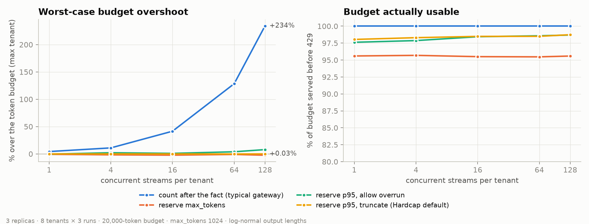
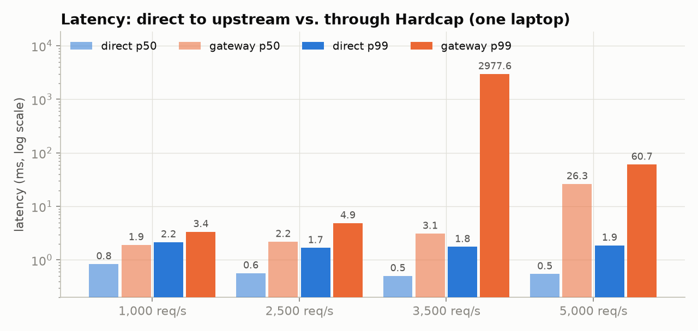
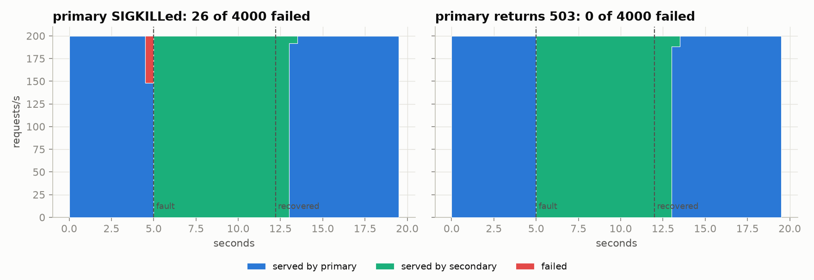

# Hardcap

**A self-hosted LLM gateway that enforces per-tenant token budgets across replicas without
overshooting, and publishes the load tests to prove it.**

Most gateways count tokens *after* a response finishes and reject new requests once
`used >= limit`. With 128 streams in flight per tenant across 3 replicas, that lets a tenant
spend **3.3× its budget**. Hardcap reserves an estimate up front, grows the reservation while
the stream runs, and settles to the real count. Worst case in the same test: **+0.03%**
(5 tokens over a 20,000-token budget).



| 128 concurrent streams per tenant, 3 replicas | Worst overshoot | Budget usable | Streams truncated per tenant |
|---|---:|---:|---:|
| Count after the fact (typical gateway) | **+234.3%** | 100% | 0 |
| Reserve `max_tokens` | −2.4% (never over) | 95.6% | 0 |
| Reserve rolling p95, allow overrun | +7.9% | 98.7% | 0 |
| **Reserve rolling p95, truncate (default)** | **+0.03%** | **98.7%** | 1.2 |

*8 tenants × 3 runs per cell, 20,000-token total budget each, `max_tokens` 1024, log-normal output
lengths (median 150). Ground truth is what the upstream actually generated per tenant, not the
gateway's own ledger. Full sweep (1–128 streams) in
[`bench/results/overshoot.json`](bench/results/overshoot.json).*

Read the table as a trade-off. Reserving `max_tokens` never overshoots, but it holds the full cap
for every in-flight stream, so about 4% of each budget can never be used, and clients see
thousands of `budget_busy` retries. Reserving the rolling p95 fixes utilization. Truncation then
closes the remaining gap: on average about one stream per tenant, the one that hits the end of
the budget, ends early with `finish_reason: "length"`.

## What it does

- **OpenAI-compatible endpoint** (`/v1/chat/completions`, streaming and not) in front of
  OpenAI-compatible upstreams (OpenAI, vLLM, …) and Anthropic (translated both ways)
- **Token budgets per tenant**: input, output and total, per fixed window, enforced across any
  number of stateless replicas through Redis Lua scripts
- **Reserve → extend → settle** accounting with pluggable estimators (`max_tokens`, `fixed`,
  rolling `p95`), and crash-safe reservations that expire if a replica dies
- **Request rate limits**: sliding-window counter or token bucket, checked in the same atomic
  script as the budget, so a rejected request costs nothing
- **Fallback chains** on 429, 5xx, timeouts and connection errors, with per-upstream circuit
  breakers
- **Cost attribution** per tenant, route and model, exported to Prometheus (Grafana dashboard
  included)

Not goals: 100+ providers (that's [LiteLLM](https://github.com/BerriAI/litellm)), a hosted
service, an admin UI.

## Quickstart

Try it in a minute with the built-in mock LLM (no API key needed):

```bash
pip install hardcap                                   # or: uv tool install hardcap
docker run -d -p 6379:6379 redis:7-alpine
curl -sO https://raw.githubusercontent.com/saikirankalidindi/hardcap/main/examples/local.yaml
hardcap mock --port 9001 &
hardcap serve -c local.yaml
curl -N localhost:8080/v1/chat/completions -H 'authorization: Bearer sk-alpha' \
  -d '{"model":"demo","stream":true,"max_tokens":200,"messages":[{"role":"user","content":"hi"}]}'
curl localhost:8080/v1/hardcap/usage -H 'authorization: Bearer sk-alpha'
```

The container image is `ghcr.io/saikirankalidindi/hardcap` (amd64 and arm64):

```bash
docker run -p 8080:8080 -v $PWD/config.yaml:/etc/hardcap/config.yaml ghcr.io/saikirankalidindi/hardcap
```

Or run the whole demo stack (3 replicas, 2 mock upstreams, Redis, Prometheus, Grafana on
`:3000`):

```bash
docker compose -f deploy/docker-compose.yml up --build
curl -N localhost:8081/v1/chat/completions -H 'authorization: Bearer sk-alpha' \
  -d '{"model":"demo","stream":true,"messages":[{"role":"user","content":"hi"}]}'
curl localhost:8082/v1/hardcap/usage -H 'authorization: Bearer sk-alpha'   # any replica, same ledger
```

A real-provider config is in [`examples/config.yaml`](examples/config.yaml). Any OpenAI SDK
works: point `base_url` at Hardcap and use a tenant key as the API key.

## How it works

```
client ──► replica ──admit.lua──► Redis   rate limit + reclaim expired reservations
             │                            + check used+reserved+estimate ≤ limit, reserve
             ├──► upstream (fallback chain, circuit breakers)
             │      stream ──► every 64 tokens: extend.lua (grow reservation, or truncate)
             └──settle.lua──► Redis       release reservation, charge actual usage
```

The invariant `used + reserved ≤ limit` holds after every admit and extend, because Redis runs
each script atomically. Overshoot can only come from tokens generated without a reservation, and
truncate mode doesn't allow any. The rest of the argument, the failure modes and the known gaps
are in [`docs/design.md`](docs/design.md).

Budget rejections are split so clients can act on them:

| `error.type` | Meaning | `Retry-After` |
|---|---|---|
| `budget_exceeded` | the window's budget is spent | until the window resets |
| `budget_busy` | the rest is held by in-flight requests | 1 s |
| `rate_limit_exceeded` | request-rate limit | until a slot frees |

## Other benchmarks

### Latency overhead



| Load (unary, 20-token responses) | Direct p50 / p99 | Through Hardcap p50 / p99 | Added p50 / p99 |
|---|---:|---:|---:|
| 1,000 req/s | 0.8 / 2.2 ms | 1.9 / 3.4 ms | **+1.1 / +1.2 ms** |
| 2,500 req/s | 0.6 / 1.7 ms | 2.2 / 4.9 ms | **+1.6 / +3.2 ms** |
| 1,000 req/s, streaming | 0.9 / 2.4 ms | 2.9 / 5.3 ms | **+1.9 / +3.0 ms** |

Full path on: auth, two Redis Lua round trips, reservation, settlement, Prometheus metrics.
Open-loop load, with latency measured from each request's *scheduled* send time (no coordinated
omission).

**Where it breaks:** 5 Python worker processes saturate between 2,500 and 5,000 req/s *on this
machine*, and the knee is unstable from run to run. In one run 5,000 req/s held at p99 61 ms while
3,500 collapsed; in another, 5,000 dropped to 3,400 req/s. The load generator, gateway, mock
upstream and Redis all share one 12-thread laptop CPU (i5-12450H), so read this as a floor, not a
ceiling. Profiling put about 65% of handler CPU in the Redis client; adding `hiredis` moved one
worker's knee from about 1,300 to above 1,600 req/s. If raw throughput were the headline, the hot
path would be written in Go. It isn't: the headline is correctness, and the gateway adds about
1–2 ms to calls that take hundreds of milliseconds.

### Failover



Primary → secondary route, 200 streaming req/s, breaker threshold 5, cooldown 2 s.

| Scenario | Failed requests | What failed | Back on primary after recovery |
|---|---:|---|---:|
| Primary process SIGKILLed at t=5 s | 26 / 4,000 (0.65%) | only streams already in flight on the killed process; every request sent after the kill succeeded | 0.8 s |
| Primary returns 503 for 7 s | **0 / 4,000** | none (p99 latency unchanged) | 1.0 s |

A stream that has already sent bytes to the client can't be retried transparently, by any
gateway. Those 26 got an SSE error event.

## Reproduce

```bash
uv sync --extra bench
docker run -d -p 6379:6379 redis:7-alpine
uv run pytest                        # 28 tests, including end-to-end through mock upstreams
uv run python bench/overshoot.py     # ~15 min; --quick for a smoke run
uv run python bench/overhead.py --gateway-workers 5 --rates 1000,2500,3500,5000
uv run python bench/failover.py
uv run python bench/plot.py          # regenerates docs/img/*.png from bench/results/*.json
```

Raw results, with machine info and every parameter, are committed in
[`bench/results/`](bench/results/).

## Limitations

- **Input tokens are estimated** (about 4 characters per token) at admission and corrected at
  settlement. The mock upstream uses the same estimate, so input-tokenizer mismatch is **not**
  measured above.
- **One machine.** Every component shares the CPU; there is no network latency between gateway
  and Redis.
- **Fixed windows** (aligned to the epoch): a tenant can spend a full budget on each side of a
  boundary.
- **A crashed replica's in-flight usage is lost.** Its reservations are reclaimed after the TTL,
  but tokens the upstream billed for those streams are never charged.
- **The p95 estimator is per replica.** Each replica reserves `max_tokens` until it has 50
  samples.

## Roadmap

- [ ] Exact tokenizers per route, and a reservation safety margin for input tokens
- [ ] Per-tenant priority queues instead of `budget_busy` rejections
- [ ] Semantic cache with hit-rate reporting
- [ ] OpenTelemetry traces
- [ ] Multi-host benchmark (gateway, Redis and load generator on separate machines)

## License

Apache-2.0
